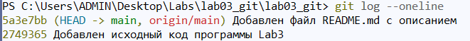
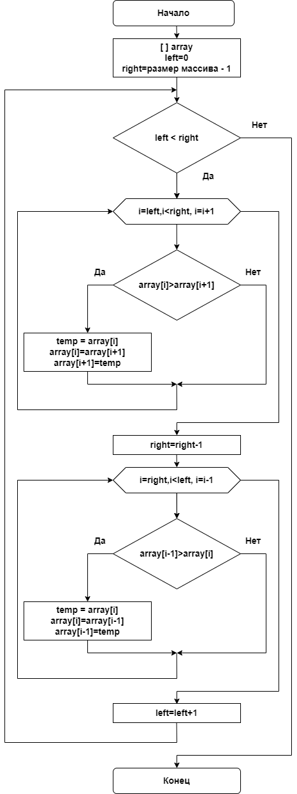

# Лабораторная работа №3

**Тема:** Работа с массивами, сортировка и обработка исключений

## Задание

Разработать консольное приложение с меню, реализующее игру "Угадай ответ", вывод информации об авторе и сравнение алгоритмов сортировки (пузырек и шейкер).

## Как запустить

1. Откройте решение в Visual Studio.
2. Нажмите F5 или выберите "Запустить без отладки".
3. Следуйте инструкциям в консольном меню.

## Пример работы

**Ввод:**
Выберите пункт меню: 1
Введите значение a: 0
Введите значение b: 2.718

**Вывод:**
Функция: ln^2(b) / (cos(a)-1)
...
Угадайте ответ (осталось попыток 3): 1.0
Вы угадали! Правильный ответ: 1.0

## Автор и группа

**Студент:** Новиков Артем Владимирович
**Группа:** 6104-090301D

## Дополнительные материалы

### Скриншот работы программы (терминал)

### Схема алгоритма сортировки

